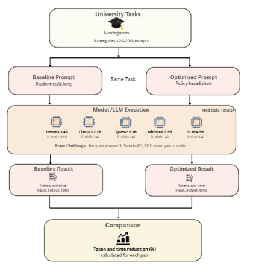
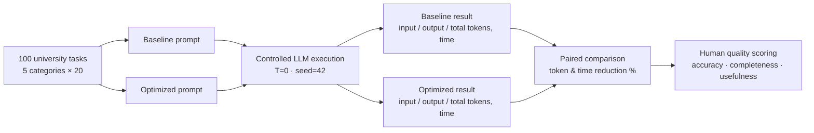

<div align="center">

# 🌱 Green LLM Token Research

### Reducing Token Waste in Student LLM Use for University Learning Tasks
**Implications for Sustainable AI Computing**


*Can a clearer, shorter prompt cut computational effort without hurting what a student actually learns?*

</div>

---

## 📑 Table of Contents

1. [Overview](#-overview)
2. [Experimental Design at a Glance](#-experimental-design-at-a-glance)
3. [Task Categories](#-task-categories)
4. [Methodology](#-methodology)
5. [Models and Environments](#-models-and-environments)
6. [Controlled Settings](#-controlled-settings)
7. [Measurements and Quality Evaluation](#-measurements-and-quality-evaluation)
8. [Current Status and Early Results](#-current-status-and-early-results)
9. [Repository Structure](#-repository-structure)
10. [Data Files](#-data-files)
11. [Validation Checklist](#-validation-and-reproducibility)
12. [Analysis Workflow](#-analysis-workflow)
13. [Limitations](#-limitations)
14. [Research Principles](#-research-principles)

---

## 🔎 Overview

Students now use large language models for assignments, exam revision, coding labs, and reading research papers. Many of these prompts are long, repetitive, or loosely structured, and every extra token costs computation.

This project asks one focused question:

> **Can unnecessary token consumption in university-related LLM interactions be reduced through prompt optimization, while keeping the response accurate, complete, and educationally useful?**

For every task we write **two versions of the same request**:

| Version | Description |
|---|---|
| **Baseline** | A normal, student-style prompt: natural, often long and loosely organized. |
| **Optimized** | A shorter, clearer, more structured prompt asking for the *same* educational outcome. |

The goal is **not** simply shorter prompts. The goal is to reduce **total token use and computational effort** while the required educational outcome stays exactly the same.

---

## 🧪 Experimental Design at a Glance

| Item | Value |
|---|---|
| Underlying university-learning tasks | **100** |
| Task categories | **5** (20 tasks each) |
| Prompt variants per task | **2** (baseline, optimized) |
| Primary executions per variant | **1** |
| Runs per model | **200** |
| Final LLM models | **4** |
| Total primary runs | **800** |

```text
100 tasks × 2 variants  = 200 runs per model
200 runs × 4 models     = 800 primary runs
```

---

## 🗂️ Task Categories

| # | Category | Example focus |
|---|---|---|
| 1 | `assignment_writing` | Drafting and explaining coursework answers |
| 2 | `exam_preparation` | Revision, practice questions, study support |
| 3 | `programming_help` | Lab and coursework coding tasks |
| 4 | `concept_learning` | Understanding course concepts |
| 5 | `research_paper_summarization` | Summarizing paper content for formal research |

### Academic Scope

A task is included only when its context clearly links the LLM interaction to a **university course, assignment, examination, coursework, laboratory activity, university learning, or formal research**.

Classification depends on the **purpose and context** of the interaction, not only on the prompt topic. Ambiguous, general-purpose tasks are excluded.

---

## 🧭 Methodology

<div align="center">



</div>

The pipeline moves from a fixed task set, through two prompt variants, into controlled model execution, and ends with a pair-by-pair comparison.



### 1️⃣ Dataset Preparation

A larger pool of candidate prompt pairs was prepared across the five categories. For the final experiment, **20 pairs per category** were selected, giving **100 tasks**.

Each task stores the academic task, the baseline prompt, the optimized prompt, the category, and any required supporting context. The final dataset lives at:

```text
green_llm_ready_bundle/green_llm_ready_100_prompts.csv
```

An Excel copy is included for manual review.

### 2️⃣ Baseline vs Optimized Prompts

Both prompts must request the **same educational outcome**. The optimized prompt may remove unnecessary wording and improve structure, but it may **never** shrink the required work just to produce a shorter answer.

All 100 pairs were manually reviewed before execution, and small fairness corrections were applied where needed so both versions represent the same task.

### 3️⃣ Supporting Context

Some tasks need source material such as assignment information, code, reading material, or paper content. These are stored as project context files and **automatically appended** to the relevant prompt.

For research-paper summarization, we use **researcher-created synthetic papers** as controlled stimuli. They are *not* real published papers; they were written so identical source material could be reused consistently across every model run.

### 4️⃣ P0003 Replacement

During the original Gemma experiment, the first version of `P0003` kept failing with:

```text
prediction aborted, token repeat limit reached
```

Because the failure persisted under the fixed settings, we chose **not** to alter model settings for a single prompt. Instead, P0003 was replaced with reserve Assignment Writing pair **`1.26`**, a Corporate Finance task on interpreting a positive NPV result.

Both variants were replaced together, and the same replacement dataset is used in all later model experiments.

### 5️⃣ Run Order

To reduce order bias:

- **odd-numbered** tasks → baseline runs first
- **even-numbered** tasks → optimized runs first

A warm-up request is sent before measured runs begin. It is excluded from results.

### 6️⃣ Experiment Runner

The Python runner:

- loads the final CSV dataset
- appends the required context
- sends requests to the Ollama API
- records the full response, token counts, and timing
- saves every completed run immediately
- retries temporary failures
- **resumes safely** after interruption, skipping completed `(prompt_id, variant)` pairs

---

## 🤖 Models and Environments

| Model | Ollama identifier | Environment |
|---|---|---|
| **Gemma 3 4B** | `gemma3:4b` | Local PC · AMD Ryzen 7 7700 CPU |
| **Llama 3.2 3B Instruct** | `llama3.2:3b-instruct-q4_K_M` | Google Colab · NVIDIA T4 GPU |
| **Qwen2.5 3B Instruct** | `qwen2.5:3b-instruct` | Google Colab · NVIDIA T4 GPU |
| **Ministral 3 3B Instruct** | `ministral-3:3b-instruct-2512-q4_K_M` | Google Colab · NVIDIA T4 GPU |

> **Abandoned Phi pilot.** Phi-3.5 Mini 3.8B was briefly tested as a possible fourth model. Its P0001 baseline repeatedly fell into the same token-repeat failure, so the full Phi experiment was not run and Ministral took its place.

---

## ⚙️ Controlled Settings

Everything that could influence the output is held constant:

```text
Temperature:            0
Seed:                   42
Runs per prompt variant: 1
```

The same dataset and context files are used for every model.

---

## 📏 Measurements and Quality Evaluation

### Efficiency metrics

For each matched baseline/optimized pair we compare:

| Metric | Question answered |
|---|---|
| Input-token reduction | Did the optimized prompt send fewer tokens? |
| Output-token reduction | Did the model generate fewer tokens? |
| Total-token reduction | Did the whole interaction get cheaper? |
| Response-time reduction | Was it faster? |
| Fewer total tokens? | Yes / No per pair |
| Faster completion? | Yes / No per pair |

```text
total tokens = input tokens + output tokens
```

Total tokens matter because a shorter prompt can sometimes trigger a **longer answer**, so input reduction alone is never treated as proof of efficiency.

### Data recorded per run

Each successful run stores a raw JSONL record with: timestamp, prompt ID, source pair ID, category, task description, prompt variant, run order, model, temperature, seed, prompt text, context file, full prompt sent, full generated response, input / output / total tokens, wall-clock time, Ollama timing information, and completion reason.

> Raw model outputs are **never manually edited**.

### Human quality evaluation

Token savings only count if quality holds. Responses are scored by humans on three dimensions, each an integer from **1 to 5**:

| Dimension | What it checks |
|---|---|
| ✅ **Accuracy** | Is the content correct? |
| 📋 **Completeness** | Does it cover everything the task required? |
| 🎓 **Educational Usefulness** | Would it genuinely help a student learn? |

The same standard applies to baseline and optimized responses. A shorter answer can still score high if it is accurate, complete, and useful.

### Multi-model comparison

The same 100-task protocol is repeated across all four models. The purpose is **not to rank models**, but to see whether prompt optimization produces a *similar efficiency effect across different LLM families*.

Because Gemma ran on a local CPU while the others ran on Colab T4 GPUs, raw latency is **not** used to compare model speed. Latency is interpreted only as the baseline-to-optimized change **within the same model and environment**.

### Sustainability interpretation

This study directly measures input tokens, output tokens, total tokens, and response latency. It does **not** directly measure electricity, carbon emissions, or water use. Environmental implications are discussed separately, using relative computational-efficiency reasoning and supporting literature.

---

## 📊 Current Status and Early Results

| Model | Status | Runs |
|---|---|---|
| Gemma 3 4B | ✅ Completed and validated | 100 baseline + 100 optimized |
| Ministral 3 3B Instruct | ✅ Completed and validated | 100 baseline + 100 optimized |
| Llama 3.2 3B Instruct | 🔄 Separate Colab experiment, same 100-pair protocol | — |
| Qwen2.5 3B Instruct | 🔄 Separate Colab experiment, same 100-pair protocol | — |

### Initial summaries (completed models)

| Metric | Gemma 3 4B | Ministral 3 3B |
|---|---:|---:|
| Input-token reduction | 54.82% | 17.45% |
| Output-token reduction | 15.13% | 16.88% |
| **Total-token reduction** | **23.67%** | **17.16%** |
| Wall-time reduction | 17.19% | 17.32% |
| Optimized used fewer total tokens | 83 / 100 pairs | 70 / 100 pairs |
| Optimized was faster | 80 / 100 pairs | 63 / 100 pairs |

The final cross-model analysis will be completed once all four raw result files are collected.

---

## 📁 Repository Structure

```text
green-llm-token-research/
├── green_llm_ready_bundle/
│   ├── green_llm_ready_100_prompts.csv
│   ├── green_llm_ready_100_prompts.xlsx
│   ├── context_manifest.csv
│   ├── synthetic_paper_catalog.csv
│   ├── README.txt
│   └── contexts/
│
├── data/
│   ├── raw/
│   │   ├── runs.jsonl                        # Gemma (original experiment)
│   │   ├── runs_llama32_3b_colab.jsonl
│   │   ├── runs_qwen25_3b_colab.jsonl
│   │   └── runs_ministral3_3b_colab.jsonl
│   ├── evaluation/
│   │   └── quality_scores.csv
│   └── processed/
│       └── results.csv
│
├── scripts/
│   ├── run_experiment.py
│   ├── run_experiment_llama32_colab.py
│   ├── run_experiment_qwen25_colab.py
│   ├── run_experiment_ministral3_colab.py
│   ├── process_results.py
│   ├── summarize_results.py
│   └── validate_prompts.py
│
├── config/
├── logs/
├── notebooks/
├── figures/
└── README.md
```

---

## 🗃️ Data Files

| Purpose | Path |
|---|---|
| Final prompt dataset (CSV) | `green_llm_ready_bundle/green_llm_ready_100_prompts.csv` |
| Final prompt dataset (Excel) | `green_llm_ready_bundle/green_llm_ready_100_prompts.xlsx` |
| Context manifest | `green_llm_ready_bundle/context_manifest.csv` |
| Synthetic paper catalog | `green_llm_ready_bundle/synthetic_paper_catalog.csv` |
| Raw results | `data/raw/runs*.jsonl` (`runs.jsonl` = original Gemma run) |
| Human quality scores | `data/evaluation/quality_scores.csv` |
| Processed pair results | `data/processed/results.csv` |

---

## ✔️ Validation and Reproducibility

**Before a full experiment, confirm:**

- [ ] the final 100-pair dataset is present
- [ ] `P0003` uses replacement source pair `1.26`
- [ ] all required context files exist
- [ ] the correct model is loaded
- [ ] temperature is `0` and seed is `42`
- [ ] the output filename is unique to that model

**After a full experiment, confirm:**

- [ ] 200 total records (100 baseline + 100 optimized)
- [ ] 200 unique `(prompt_id, variant)` combinations
- [ ] one consistent model / temperature / seed configuration
- [ ] non-empty generated responses
- [ ] positive token counts and response times
- [ ] normal completion reasons

---

## 🔄 Analysis Workflow

```text
1. Validate raw model outputs
2. Convert raw JSONL into paired baseline/optimized results
3. Calculate token and latency reductions
4. Compare results by task category
5. Perform human quality evaluation
6. Compare efficiency results with quality scores
7. Check whether the optimization pattern is consistent across models
8. Interpret computational and sustainability implications
9. Document limitations and final conclusions
```

---

## ⚠️ Limitations

- **Token count is a proxy.** Token reduction indicates reduced computational workload; it is not a direct measurement of environmental impact.
- **Synthetic papers.** Research-paper tasks use controlled synthetic papers instead of real publications. This improves control but lowers ecological validity for that category.
- **Mixed hardware.** Models were not all run on identical hardware, so raw latency cannot serve as a cross-model speed comparison.

---

## 📜 Research Principles

1. Baseline and optimized prompts represent the same underlying task.
2. Optimization must not intentionally reduce the required educational outcome.
3. The same final 100-task dataset is used across models.
4. Raw experimental outputs are never manually overwritten.
5. Failed executions and important retries stay documented.
6. Input, output, and total tokens plus latency are the directly measured variables.
7. Shorter input is never assumed to be more efficient; total tokens are evaluated too.
8. Response quality is judged separately with the predefined human rubric.
9. Environmental implications are estimated apart from directly measured variables.
10. Cross-hardware latency is not used to rank model speed.

---

<div align="center">

### 🎯 Project Goal

To determine whether clearer, more efficient prompting can reduce unnecessary LLM token consumption in university learning tasks **while preserving useful educational responses**, and whether this effect holds consistently across multiple LLM families.

</div>
